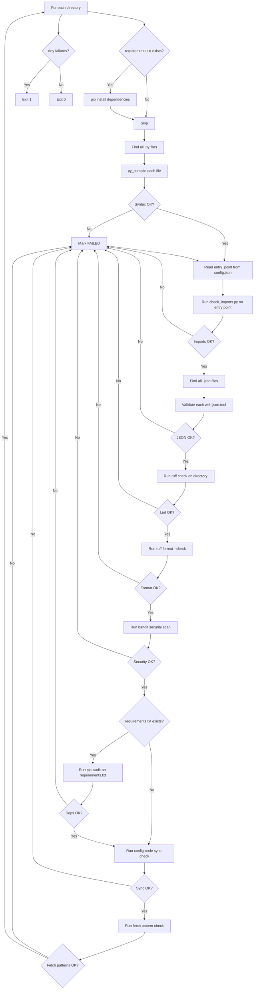

# check_code.py

Runs code quality checks on one or more integration directories.

## Overview

This script performs ten sequential code quality checks on each given integration directory:

1. **Dependency installation** — installs `requirements.txt` so import checks can find third-party packages
2. **Python syntax check** — uses `py_compile.compile()` directly to catch syntax errors
3. **Import availability check** — imports `check_imports()` as a function to verify modules exist
4. **JSON validity check** — uses `json.load()` directly to ensure all `.json` files are parseable
5. **Lint check** — runs `ruff check` to catch code quality issues (undefined names, unused imports, style errors)
6. **Format check** — runs `ruff format --check` to enforce consistent code formatting
7. **Security scan** — runs `bandit` to flag hardcoded secrets, unsafe eval/exec, insecure HTTP calls
8. **Dependency vulnerability scan** — runs `pip-audit` to check requirements.txt for packages with known CVEs
9. **Config-code sync** — runs `check_config_sync.py` to verify config.json actions and input schemas match the code
10. **Fetch pattern check** — runs `check_fetch_pattern.py` to flag SDK 2.x `context.fetch()` response handling issues

When `--base-ref` is provided, the config-code sync step treats input-schema drift as fatal for brand-new integrations while preserving warning-only behaviour for integrations that already existed at the base ref. The base ref must resolve locally; otherwise config-code sync exits with a processing error instead of classifying integrations as new.

## Usage

```bash
python scripts/check_code.py [--base-ref <ref>] <dir> [dir ...]
```

### Arguments

| Argument | Required | Description |
|----------|----------|-------------|
| `--base-ref` | No | Git ref used by config-code sync to fail input drift only for brand-new integrations. Must resolve locally. |
| `dir` | Yes (one or more) | Path to an integration directory to check |

### Exit Codes

| Code | Meaning |
|------|---------|
| `0`  | All checks passed for all directories |
| `1`  | One or more checks failed |
| `2`  | Usage or processing error, including an unresolvable `--base-ref` reported by config-code sync |

### Examples

```bash
# Check a single integration
python scripts/check_code.py my-integration

# Check multiple integrations
python scripts/check_code.py my-integration another-api

# Fail config/code input drift only for brand-new integrations compared with the base ref
python scripts/check_code.py --base-ref origin/main my-integration

# Combine with get_changed_dirs.py
python scripts/check_code.py $(python scripts/get_changed_dirs.py origin/main)
```

## Checks Performed

### 1. Dependency Installation

```bash
pip install -r <dir>/requirements.txt -q
```

- Runs only if `requirements.txt` exists
- Uses `-q` (quiet) to reduce output noise
- Failures are silently ignored (`|| true`) to allow checks to continue

### 2. Python Syntax Check

```bash
python -m py_compile <file.py>
```

- Finds all `.py` files recursively in the directory using `pathlib.glob()`
- Uses `py_compile` module to check syntax without executing code
- Reports each file with syntax errors individually

**On failure:**
```
🐍 Checking Python syntax...
   ❌ my-integration/broken_file.py

   Fix: Check the Python files above for syntax errors
   Run locally: python -m py_compile <file.py>
```

### 3. Import Availability Check

```bash
python scripts/check_imports.py <dir>/<entry_point>
```

- Reads `entry_point` from `config.json` to determine the main Python file
- Temporarily adds the integration directory to `sys.path` so local imports (e.g. `import actions`) are resolvable, mirroring Python's runtime behaviour for entry points
- Calls `check_imports()` directly as a function (see [check_imports.md](check_imports.md)) to verify all imports
- Skips gracefully if `config.json` or the entry point file doesn't exist

**On failure:**
```
📥 Checking imports...
   ❌ Import errors in my-integration/main.py

   Fix: Install missing packages in requirements.txt
   Or check if package name is spelled correctly
```

### 4. JSON Validity Check

```bash
python -m json.tool <file.json>
```

- Finds all `.json` files recursively in the directory using `pathlib.glob()`
- Uses Python's built-in `json.load()` to validate syntax
- Reports each invalid JSON file individually

**On failure:**
```
📄 Checking JSON files...
   ❌ my-integration/config.json

   Fix: Check for missing commas, quotes, or brackets
   Validate at: https://jsonlint.com/
```

### 5. Lint Check (ruff)

```bash
ruff check <dir>
```

- Runs [ruff](https://docs.astral.sh/ruff/) linter on all Python files in the directory
- Checks for pyflakes errors (F), pycodestyle errors (E), and pycodestyle warnings (W)
- Configuration is defined in `ruff.toml` at the repository root
- Ruff is installed automatically if not already available

**On failure:**
```
🔍 Linting with ruff...
   my-integration/main.py:5:1: F401 `os` imported but unused

   ❌ Lint errors found

   Fix: Run 'ruff check --fix' to auto-fix some issues
```

### 6. Format Check (ruff format)

```bash
ruff format --check <dir>
```

- Checks that all Python files are formatted consistently
- Uses the same ruff tool (already installed for linting)
- Does not modify files — only reports which files would be reformatted

**On failure:**
```
🎨 Checking formatting with ruff...
   Would reformat: my-integration/main.py

   ❌ Formatting issues found

   Fix: Run 'ruff format' to auto-format
```

### 7. Security Scan (bandit)

```bash
bandit -r <dir> -x .venv,venv,__pycache__,site-packages,dependencies -s B101 -q
```

- Runs [bandit](https://bandit.readthedocs.io/) security linter on all Python files
- Excludes virtual environment, cache, and dependency directories from scanning
- Flags hardcoded passwords, use of `eval`/`exec`, insecure HTTP calls, and other security anti-patterns
- Skips B101 (assert_used) since test files use assertions
- Uses `-q` (quiet) to only show findings

**On failure:**
```
🔒 Scanning for security issues with bandit...
   >> Issue: [B105:hardcoded_password_string] Possible hardcoded password: 'secret123'
      Severity: Low   Confidence: Medium
      Location: my-integration/main.py:15:0

   ❌ Security issues found

   Fix: Review flagged code for security risks
   Run locally: bandit -r <dir> -x .venv,venv,__pycache__,site-packages,dependencies -s B101
```

### 8. Dependency Vulnerability Scan (pip-audit)

```bash
pip-audit -r <dir>/requirements.txt
```

- Runs [pip-audit](https://github.com/pypa/pip-audit) against the integration's requirements.txt
- Checks all listed dependencies for known CVEs (Common Vulnerabilities and Exposures)
- Only runs if `requirements.txt` exists

**On failure:**
```
🛡️ Checking dependencies for vulnerabilities with pip-audit...
   Name    Version ID             Fix Versions
   ------- ------- -------------- ------------
   requests 2.25.0 PYSEC-2023-XXX 2.31.0

   ❌ Vulnerable dependencies found

   Fix: Update affected packages in requirements.txt
```

### 9. Config-Code Sync Check

```bash
check_config_sync.py [--base-ref <ref>] <dir>
```

- Uses AST parsing to extract `@action` decorators and `inputs` access patterns from the entry point
- Cross-validates action names and input parameters between `config.json` and code
- Detects undocumented parameters, dead schema fields, and required/optional mismatches
- With `--base-ref`, action mismatches always fail, while input drift fails only for integrations whose `config.json` did not exist at the base ref. Existing integrations, including integrations renamed from an existing path, keep input drift as warnings.
- If `--base-ref` cannot be resolved from the integration's git repository, the processing error is reported and `check_code.py` exits with code `2`.

**On failure:**
```
🔗 Checking config-code sync...
   ⚠️ Action 'send_email' in config.json but not found in code
   ❌ Input 'recipient' declared in config.json but never accessed in code
   ❌ Input 'priority' accessed in code but missing from config.json schema

   ❌ Config-code sync errors found

   Fix: Ensure config.json actions and input schemas match the code
   Run locally: python scripts/check_config_sync.py [--base-ref <ref>] <dir>
```

### 10. Fetch Pattern Check

```bash
check_fetch_pattern.py <dir>
```

- Uses the same SDK requirement parser as structure validation and packaging, including normalized package names and combined version constraints. Missing, malformed, or unsupported declarations fail instead of silently skipping the check. The existing pin policy still requires a stable `~=` or exact pin; `>=2.1.0,<3` alone is not accepted.
- For SDK 2.x and later, detects raw-response subscripts, `.get()`, dict/list `isinstance` checks (including `dict | list`), and raw responses passed to SDK `ActionResult(data=...)`. SDK 1.x retains raw-body semantics.
- Tracks straightforward response and context aliases, annotated assignments, SDK root/defining-module imports, type aliases, and reassignment to `.data` in source order. Captures recognizable expression provenance before evaluating its effects, so argument-side rebinding does not change an already captured fetch receiver. Function, lambda, and comprehension scopes are separate; method bodies do not inherit class attributes. A class comprehension uses the class namespace only for its first iterable. Comprehension walrus assignments invalidate affected enclosing bindings without assuming an iteration occurs. `isinstance(response, FetchResponse)` and known aliases of that SDK class remain valid, as do access to `.status` and `.headers`. Unknown assignments and parameters that shadow `dict`, `list`, or `isinstance` do not restore builtin proof.
- Checks function and lambda defaults, decorators, and class bases and keywords in their enclosing scope, before binding the new definition or its parameters. Checks eager function annotations in parameter order, including variadic parameters, and eager module/class annotations under Python 3.13 semantics. Function-local variable annotations remain unevaluated even on statements with assigned values; strings, future annotations, and lazy `type` alias values and bounds also remain deferred. Assignment-target receivers and indexes are inspected where Python evaluates them, including annotation-only statements and `with` targets. Unpacking targets are processed left-to-right without inferring the destructured values.
- Inspects call arguments and dictionary key/value pairs in evaluation order, including dictionary unpacking. SDK `ActionResult(data=...)` is checked when that argument is evaluated, so an earlier reassignment is respected and a later reassignment does not change an already captured argument. Recognized `ActionResult` and builtin `isinstance` callees are captured before evaluating their arguments.
- Variadic parameter annotations describe elements, not the `*args` tuple or `**kwargs` dictionary; those container bindings remain unproven. Explicit generic type parameters shadow imported SDK symbols in their annotation/body scopes without evaluating lazy bounds or inferring generic types.
- Merges conditional expressions, short-circuit boolean and chained-comparison paths, and loop `else` paths without assuming every path executes. The first comparator is mandatory; later comparators can short-circuit. Assertion messages are inspected but cannot change successful fallthrough bindings; assertion tests remain mandatory. Exception handlers discard proof for names the try body can overwrite, rather than assuming the body either completes or makes no assignments. Later handlers also discard proof affected by earlier exception-type expressions or, for `except*`, earlier handler bodies. `finally` and code after `with`/`async with` also account for partial execution and potentially suppressed exceptions, without inferring throw sites or context-manager behavior.
- Nested function/class local assignments do not invalidate the enclosing scope. Explicit class-body `nonlocal` and `global` declarations invalidate proof for those escaped names, including in enclosing try handlers; the checker does not infer their new values or assignments across method calls. Deletion clears name proof and inspects evaluated target receivers/indexes without inferring fallback values.
- Analyzes `match` case bodies independently, clears pattern-capture bindings, and accounts for unmatched paths when merging results. Later cases do not retain a proven binding that an earlier pattern or guard can overwrite.
- Wildcard imports discard existing symbol proof, including on exceptional paths, because their exports can replace SDK or builtin aliases. Explicit SDK imports after a wildcard can establish proof again; wildcard exports themselves are not inferred.
- Function/lambda bodies and deferred generator-expression parts discard proof for captured names that enclosing statements can overwrite, including later portions of the current statement and explicit or wildcard imports. Generator first iterables remain eager, as do list/set/dict comprehensions. Defaults, decorators, and eager annotations still use the defining scope at evaluation time; parameter annotations establish their own proof. Class-local assignments do not overwrite method closures. The checker does not infer invocation timing, generator consumption, or helper return values.
- Inspects deployment Python sources, including helper modules. Excludes development paths such as root `tests/`, `dependencies/`, virtual environments, hidden paths, and `__pycache__/`.

This is a bounded static check, not a type checker. It recognizes SDK `ExecutionContext` type annotations and constructors, including `Optional[ExecutionContext]` and `ExecutionContext | None`, plus the conventional unannotated `context` handler parameter. It does not assume that every client with a `.fetch()` method uses the SDK, infer return types across helper calls, or report a value as a raw SDK response when branches disagree about its type. A union containing an unrelated client type is not treated as a proven SDK context.

The local `hiveup check fetch <dir>`, `hiveup validate`, `hiveup ci`, and compatibility script all use this checker. For example:

```python
response = await context.fetch(url)
return ActionResult(data=response.data)  # Not data=response with SDK 2.x.
```

## How It Works



## Output Format

The script produces formatted output with emoji indicators for each check:

```
----------------------------------------
Checking: my-integration
----------------------------------------

📦 Installing dependencies...

🐍 Checking Python syntax...
   ✅ Syntax OK

📥 Checking imports...
   ✅ Imports OK

📄 Checking JSON files...
   ✅ JSON files OK

🔍 Linting with ruff...
   ✅ Lint OK

🎨 Checking formatting with ruff...
   ✅ Formatting OK

🔒 Scanning for security issues with bandit...
   ✅ Security OK

🛡️ Checking dependencies for vulnerabilities with pip-audit...
   ✅ Dependencies OK

🔗 Checking config-code sync...
   ✅ Config-code sync OK

🔄 Checking fetch patterns...
   ✅ Fetch patterns OK

========================================
✅ CODE CHECK PASSED
========================================
```

## Dependencies

- **Python** — for `py_compile`, `json`, and `check_imports`
- **pip** — for installing integration dependencies
- **check_imports** — imported as a module for import validation
- **ruff** — installed automatically for linting and formatting (configured via `ruff.toml`)
- **bandit** — installed automatically for security scanning
- **pip-audit** — installed automatically for dependency vulnerability checking
- **check_config_sync** — imported as a module for config-code sync validation

## Integration with CI

`action.yml` installs HiveUp and invokes `hiveup ci`. HiveUp owns the code result group (`syntax`, `imports`, `json`, `lint`, `format`, `security`, `audit`, `sync`, and `fetch`) and passes the base ref to checks that compare against git history. When directories are not supplied, HiveUp discovers changed integrations from that base ref.

Also exercised by the `self-test.yml` workflow against test examples in `tests/examples/` as a regression guard.
