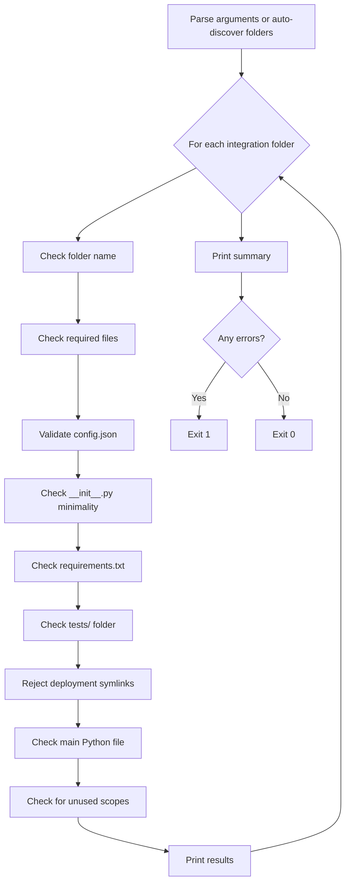

# validate_integration.py

Integration structure and configuration validator.

**Requires: Python 3.13+**

## Overview

This script validates that integration directories follow the required folder structure, naming conventions, and configuration schema. It checks for required files, validates `config.json` structure and content, verifies auth configuration, inspects action definitions, and detects potentially unused OAuth scopes.

This is the most comprehensive validation tool in the tooling suite, covering structural and configuration correctness rather than code quality (which is handled by `check_code.py`).

## Usage

```bash
# Validate specific integrations
python scripts/validate_integration.py <dir> [dir ...]

# Validate all integrations (auto-discovers integration folders at repo root)
python scripts/validate_integration.py
```

### Arguments

| Argument | Required | Description |
|----------|----------|-------------|
| `dir` | No | One or more integration directories to validate. If omitted, auto-discovers all integration folders at the repository root. |

### Exit Codes

| Code | Meaning |
|------|---------|
| `0`  | All validations passed (possibly with warnings) |
| `1`  | One or more validation errors found |
| `2`  | An error occurred (folder not found, missing arguments) |

### Examples

```bash
# Validate a single integration
python scripts/validate_integration.py my-integration

# Validate multiple integrations
python scripts/validate_integration.py my-integration another-api

# Validate all integrations in the repo
python scripts/validate_integration.py

# Combine with get_changed_dirs.py
python scripts/validate_integration.py $(python scripts/get_changed_dirs.py origin/main)
```

## Validations Performed

The validator runs 9 checks in sequence for each integration directory:

### 1. Folder Name (`_check_folder_name`)

| Check | Severity | Description |
|-------|----------|-------------|
| Lowercase | Error | Folder name must be all lowercase |
| No spaces | Error | Folder name cannot contain spaces |
| Valid characters | Warning | Should only contain `a-z`, `0-9`, and `-` |

```
✅ my-integration       (correct)
✅ shopify-admin         (correct)
❌ My-Integration        (uppercase)
❌ my integration        (spaces)
⚠️ my_integration        (underscores - warning only)
```

### 2. Required Files (`_check_required_files`)

Checks that all mandatory files exist in the integration directory:

| File | Severity | Description |
|------|----------|-------------|
| `config.json` | Error | Integration configuration |
| `requirements.txt` | Error | Python dependencies |
| `README.md` | Error | Integration documentation |
| `icon.png`, `icon.jpg`, or `icon.jpeg` | Error | Exactly one regular, non-symlink integration icon — must be exactly 512x512 pixels |
| `__init__.py` | Warning | Python package init — optional for modular integrations with an `actions/` subdirectory (adding it causes circular imports) |

### 3. config.json Validation (`_check_config_json`)

#### Required Fields

| Field | Type | Description |
|-------|------|-------------|
| `name` | string | Integration identifier |
| `version` | string | Semantic version format (`x.y.z`) |
| `description` | string | Clear description of the integration |
| `entry_point` | string | Main Python file (must exist on disk) |
| `actions` | object | At least one action must be defined |

#### Recommended Fields

| Check | Severity | Description |
|-------|----------|-------------|
| `display_name` present and non-empty | Warning | Human-readable name for the integration |

#### Auth Configuration (`_validate_auth_config`)

Validates based on `auth.type`:

| Auth Type | Required Fields | Description |
|-----------|----------------|-------------|
| `platform` | `provider`, `scopes` (array) | OAuth2-based authentication |
| `custom` | `fields.properties` | API key or token-based authentication |
| _(omitted)_ | — | No authentication (public APIs) |

#### Action Configuration (`_validate_actions_config`)

For each action defined in `config.json`:

| Check | Severity | Description |
|-------|----------|-------------|
| Action key is lowercase | Warning | Should be `snake_case` |
| `display_name` present | Warning | Human-readable name |
| `description` present | Warning | What the action does |
| `input_schema` present | Warning | JSON Schema for input |
| No root-level `anyOf`, `oneOf`, or `allOf` in `input_schema` | Error | Claude rejects these tool schemas through both Anthropic and Amazon Bedrock |
| `output_schema` present | Warning | JSON Schema for output |
| File reference with an SDK requirement below 3 | Error | Only SDK 3.0.0 or later knows the file reference |
| Unknown Autohive schema reference | Error | A `$ref` to an Autohive schema that is not a known id, for example a typing error in the file reference |
| Older file convention in an input, with SDK 3 | Error | A `file` object or a `files` array that is not declared with the file reference |
| Older file convention in an output, with SDK 3 | Warning | An object with `content`, `name` and `contentType` |
| File reference where the platform does not look | Warning | A file must be a property of an object, or the items of an array property |
| File reference under a name other than `file` or `files` | Warning | Workflows and returned files are found by these names only, for now |

Root-level input-schema combinators fail validation for both new and existing
integrations. Each error identifies the action and schema path, for example
`actions.search_companies_by_owner_name.input_schema.anyOf`. This check runs in
`hiveup check structure`, `hiveup validate`, `hiveup ci`, and the compatibility
script `validate_integration.py`.

Use an object input schema with `properties` and `required`. For alternatives
such as "provide an owner ID, email, or name", describe the accepted inputs in
the schema and enforce the cross-field requirement in the action handler.
Combinators nested inside property schemas and root-level combinators in
`output_schema` remain allowed.

#### File fields

From SDK 3.0.0, an action declares a file field with a reference to the SDK's
file schema, under any property name:

```json
"invoice": { "$ref": "https://cdn.autohive.com/schemas/sdk/file/v1.json" },
"attachments": {
  "type": "array",
  "items": { "$ref": "https://cdn.autohive.com/schemas/sdk/file/v1.json" }
}
```

These checks run on `input_schema` and `output_schema`. The checks that depend
on the SDK version use the SDK requirement in `requirements.txt`, and are left
out when that requirement cannot be read.

- **The reference needs SDK 3.** An earlier SDK does not have the schema, so the
  reference is an error when the SDK requirement is below 3.0.0.
- **An unknown Autohive reference is an error.** The only known id is the one
  above. This catches a typing error and an id from an earlier draft.
- **With SDK 3, an input must use the reference.** The platform puts files in a
  property named `file` and in an array named `files`. With SDK 3 a large file
  reaches the handler as a URL, and only a field declared with the reference is
  downloaded. So a `file` object with `content`, `name` and `contentType`, or a
  `files` array whose items are not the reference, is an error.
- **With SDK 3, an output should use the reference.** An output that still has
  the older shape works for a small file, so this is a warning. Only a `File`
  that the handler returns can be uploaded when it is too large to return inline.
- **Where a file can be declared.** The platform finds a file field in the
  `properties` of an object and in the `items` of an array. A reference in
  another place, such as inside `anyOf` or `additionalProperties`, is a warning.

- **The name of a file field, for now.** The SDK accepts a file under any name,
  and so does an agent. A workflow gives a file only to an input named `file` or
  to an array named `files`, and the platform stores a returned file only under
  those names. Under another name, a small returned file goes to the model as
  base64. Until the platform finds every file by its reference, a file reference
  under another name is a warning. This check is temporary.

With an SDK requirement below 3, the older file convention is not reported.

### 4. \_\_init\_\_.py Minimality (`_check_init_py`)

Verifies that `__init__.py` contains only import and `__all__` statements:

```python
# ✅ Correct
from .my_integration import my_integration
__all__ = ["my_integration"]

# ❌ Too much code
from .my_integration import my_integration
import logging
logger = logging.getLogger(__name__)
__all__ = ["my_integration"]
```

Allowed patterns:
- `from .module import name`
- `__all__ = [...]`

### 5. requirements.txt Check (`_check_requirements_txt`)

| Check | Severity | Description |
|-------|----------|-------------|
| `autohive-integrations-sdk` present | Error | SDK dependency is mandatory |
| Stable SDK lower bound of at least 1.0.2 | Error | Hard deployment minimum, also enforced during packaging with `--skip-validate` |
| SDK lower bound below 2.1.0 | Warning | Recommend `autohive-integrations-sdk~=2.1.0` or later, including for SDK 1.x and 2.0.x requirements |
| SDK pinned with `~=` or `==` | Error | A requirement with only `>=` or `>` can install a later major version |
| Exact SDK pin (`==` or `===`) | Warning | Use `~=` so patch releases are installed |
| SDK major version other than 1, 2 or 3 | Warning | The Tooling does not know this major version |

The recommendation checks the declared lower bound, not the SDK installed in
the Tooling environment. Newer stable SDK 2.x lower bounds do not trigger the
upgrade warning. SDK advisories do not fail validation or packaging, and
packaging still reports them with `--skip-validate`. Check SDK 2.x compatibility
before upgrading an SDK 1.x integration; dependency pins are not rewritten.

### 6. Tests Folder (`_check_tests_folder`)

| Check | Severity | Description |
|-------|----------|-------------|
| `tests/` directory exists | Error | Test directory required |
| `tests/__init__.py` exists | Error | Test package init |
| `tests/context.py` or `tests/conftest.py` exists | Error | Test import/fixture setup (either one satisfies this check) |
| `tests/test_*_unit.py` exists | Error | At least one discoverable unit test file |

### 7. Deployment Symlinks (`_check_deployment_symlinks`)

Rejects source and runtime-asset symlinks that deployment packaging cannot
include. Symlinks inside explicitly excluded development directories are
ignored. This keeps validation, isolated tests, and deployment archives aligned
without dereferencing content from outside the integration.

### 8. Main Python File (`_check_main_python_file`)

Inspects all `.py` files in the integration directory (not just the entry point) for expected patterns. This supports modular integrations where action handlers are split across multiple files.

| Check | Severity | Description |
|-------|----------|-------------|
| `Integration` imported | Warning | Should import from SDK |
| `ActionHandler` imported | Warning | Should import from SDK |
| `Integration.load(...)` called | Warning | Standard loading pattern, with or without an explicit config path |

> **Note:** Action decorator matching (config ↔ code) is handled by `check_config_sync.py`, which uses AST parsing for more accurate bidirectional validation.

### 9. Unused Scopes Detection (`_check_unused_scopes`)

For integrations using platform (OAuth2) authentication, the validator uses a heuristic to detect scopes that may not be needed:

1. Extract keywords from each scope (e.g., `read:sites` → `["read", "sites"]`)
2. Collect text from all action names, descriptions, and display names
3. Check if meaningful keywords (length > 3, not generic like `read`/`write`) appear in action text
4. Report scopes with no keyword matches as potentially unused

This is a **heuristic check** and may produce false positives — the warning asks the developer to verify manually.

## How It Works



## Auto-Discovery

When no arguments are provided, the script auto-discovers integration folders at the repository root by:

1. Iterating all directories in the repository root
2. Skipping known infrastructure directories (`.github`, `.git`, `scripts`, `tests`, `template-structure`, `__pycache__`, `.vscode`, `.idea`, `node_modules`)
3. Skipping hidden directories (starting with `.`)
4. Including directories that contain `config.json` or any `.py` file

## Output Format

### Per-Integration Output

```
============================================================
Integration: my-integration
============================================================

Errors (2):
  ❌ Missing integration icon: icon.png, icon.jpg, or icon.jpeg
  ❌ requirements.txt must include 'autohive-integrations-sdk'

Warnings (1):
  ⚠️ Version should follow semantic versioning (x.y.z): '1.0'
```

### Summary Output

```
============================================================
SUMMARY
============================================================
Integrations validated: 3
Total errors: 2
Total warnings: 1

❌ Validation FAILED - please fix errors before submitting PR
```

## Error vs Warning

| Severity | Effect | When Used |
|----------|--------|-----------|
| **Error** | Fails validation (exit 1) | Missing required files, invalid config structure, missing SDK dependency |
| **Warning** | Passes validation (exit 0) | Style issues, missing optional fields, potential unused scopes |

## Integration with CI

`action.yml` installs HiveUp and invokes `hiveup ci`. HiveUp's `structure` check owns the structure result group. When directories are not supplied, HiveUp discovers changed integrations from the supplied base ref before running the five result groups.

The script is also exercised by the `self-test.yml` workflow, which runs it against the test examples in `tests/examples/` as a regression guard whenever `scripts/` or `tests/` change.
